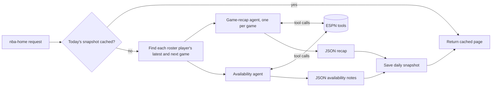

# MyTeam Analysis

An AI-powered fantasy basketball dashboard. A tool-calling LLM agent researches live NBA data to write
recaps of my players' latest games and flag anything that could affect their availability in upcoming games.
Every player also gets a stats page that compares each game against their career average.

## Features

- **Agent-written game recaps.** For the latest game day, the agent writes a summary of each game plus
  fantasy-focused bullets for every player on my roster: stat line, efficiency, role, and notable plays.
- **Availability alerts.** For each team's next game, a second agent reviews the injury report and recent
  news and flags anything that could affect playing time, such as Questionable, Out, rest or a minutes limit.
- **Player stats pages.** A game-by-game line chart against the player's career average for any of the
  9 standard fantasy categories, or overall fantasy points. Includes a season selector, season and career
  averages, and a game log that highlights the selected stat.
- **Editable roster.** Add players through a live NBA search, replace a player, or remove one, all from the
  sidebar.
- **Cost controls.** The agent runs at most once per day, results are cached in Postgres, and the
  password-protected Refresh button re-runs it on demand.
- **API status panel.** Shows OpenAI token usage, rate-limit headroom and clear error reasons (for example,
  credits running out), plus ESPN call counts.
- **Dark and light themes**, and a layout that works on mobile.

## Tech stack

| Layer | Technology |
|---|---|
| AI agent | OpenAI Responses API with function/tool calling and JSON structured outputs |
| Backend | Supabase Edge Functions (Deno, TypeScript) and Supabase Postgres for caching |
| Frontend | React 18, Vite, Tailwind CSS, Recharts, React Router, Lucide icons |
| Data | ESPN's public NBA endpoints (scores, box scores, play-by-play, schedules, injuries, news) |
| Hosting | Vercel (frontend) and Supabase (backend) |

## How the agent works



The agent is a small, framework-free tool-calling loop
([`agent.ts`](supabase/functions/_shared/agent.ts)):

1. **Tool calling.** The model gets a task (for example, "summarize game X for these players") and five tools
   ([`gameTools.ts`](supabase/functions/_shared/gameTools.ts)): `get_game_overview`, `get_player_box_score`,
   `get_player_plays`, `get_closing_plays` and `get_player_news`. It decides which ones to call. The tools
   run, their results go back to the model, and the loop repeats until it answers, up to a step limit.
2. **Grounding.** The system prompts tell the model to state only facts found in tool results, and tools
   return trimmed, relevant fields instead of raw API payloads. This reduces hallucinated stats and keeps
   token usage low.
3. **Structured outputs.** JSON mode plus an explicit output shape in the prompt, so the UI always receives
   the same format, for example `{ overall: [...], players: [{ id, bullets: [...] }] }`.
4. **Caching and cost control.**
   - Each finished game is summarized once.
   - The whole home page is saved as a daily snapshot, so most visits make no LLM calls.
   - Forced refreshes are password-protected on the server.
5. **Reliability.**
   - OpenAI errors (out of credits, invalid key, rate limits, model unavailable) are classified and shown
     in the UI.
   - Failed runs aren't cached, so the next visit retries.
   - Availability notes fall back to the raw injury report if the agent fails.

**Fantasy scoring:** "Overall" uses ESPN's default points-league scoring: PTS +1, 3PM +1, FGM +2, FGA −1,
FTM +1, FTA −1, REB +1, AST +2, STL +4, BLK +4, TO −2
([`stats.ts`](supabase/functions/_shared/stats.ts)).

## Run it locally

**Prerequisites:** Node.js 18+ and an [OpenAI API key](https://platform.openai.com/api-keys). Deno is
installed automatically as an npm dev dependency. No ESPN key is needed.

```bash
git clone https://github.com/jrana03/nba-fantasy-agent.git
cd nba-fantasy-agent
npm install
```

Create a `.env` file in the project root (copy `.env.example`) and **paste in your own OpenAI API key**:

```bash
OPENAI_API_KEY=sk-your-key-here
OPENAI_MODEL=gpt-4o-mini          # any OpenAI model that supports tool calling
REFRESH_PASSWORD=pick-a-strong-password
```

> Write `KEY=value` with no spaces around `=`. `.env` is git-ignored. Never commit your key.

Then start the app:

```bash
npm run dev
```

This starts the API at `http://localhost:8787` and the web app at **http://localhost:5173**.

- The first load of the day takes about 20–30 seconds while the agent researches games. Later loads come
  from the cache.
- Locally, the cache and roster are kept in memory and reset when the API restarts.
- To use a different API port, set `API_PORT`.

## Deploy your own

**Backend (Supabase).** Create a project, install the [Supabase CLI](https://supabase.com/docs/guides/cli),
then from the project folder:

```bash
supabase link --project-ref <your-project-ref>
supabase db push                       # creates the nba_agent_cache table
supabase secrets set --env-file .env   # OPENAI_API_KEY, OPENAI_MODEL, REFRESH_PASSWORD
npm run deploy:functions               # nba-home, nba-player, nba-roster
```

**Frontend (Vercel).** Import the repo as a Vite project and set the environment variable:

```
VITE_API_BASE=https://<your-project-ref>.supabase.co/functions/v1
```

> `.env.production` in this repo points at my backend. Change it, or set `VITE_API_BASE` in Vercel, which
> takes precedence.

Pushing to GitHub redeploys the frontend on Vercel. Backend changes need `npm run deploy:functions`.

## Project structure

```
src/                       React frontend
  pages/                   Home (recaps, upcoming games) and Player (chart, stats table)
  components/              RosterEditor, PerformanceChart, StatsTable, ApiStatus, PasswordModal, …
  lib/                     API client, roster store, theme, auth helpers
supabase/functions/
  nba-home/                Daily snapshot: games, agent recaps, availability notes
  nba-player/              Game logs, season and career averages
  nba-roster/              Read, search and edit the roster (password-protected)
  _shared/                 Agent loop, ESPN tools, caching, stats math, usage tracking
supabase/migrations/       Postgres schema for the cache table
dev/server.ts              Runs the Edge Functions locally, no Docker needed
```

## Notes

- ESPN's endpoints are public but unofficial and undocumented. This is a personal, non-commercial project.
- Endpoints that cost money or change data (agent refresh, roster edits) require `REFRESH_PASSWORD`, which is
  checked on the server and never included in the frontend.
